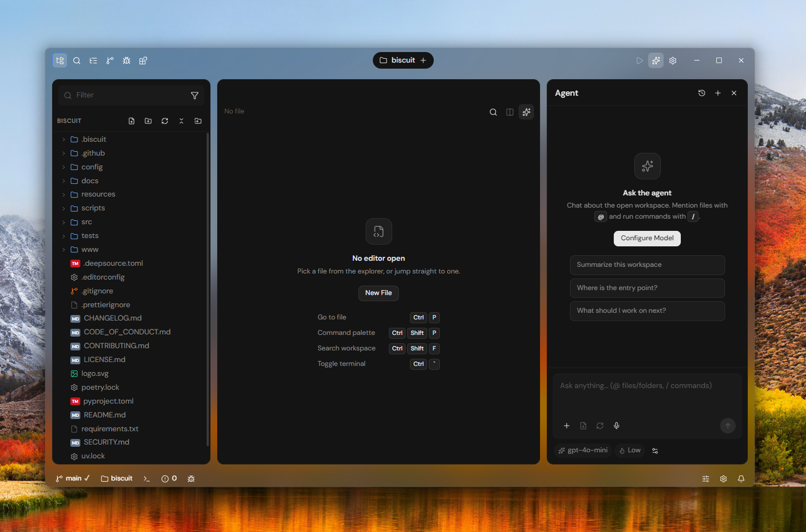

<div align="center">

# Morsel **`/ˈmɔːrsəl/`**


A code editor that respects your taste *(previously known as Biscuit).*

<br />

[](https://github.com/tomlin7/biscuit)

<br />

[](https://github.com/tomlin7/biscuit/blob/main/LICENSE)
[](https://github.com/tomlin7/biscuit/pulse)
[](https://github.com/tomlin7/biscuit/commits/main)

<br />

[Downloads](#downloads) &ensp;·&ensp; [Quickstart](#quickstart) &ensp;·&ensp; [Workspaces](#packages) &ensp;·&ensp; [Milestones](docs/MILESTONES.md) &ensp;·&ensp; [Website](https://t3d.sh) &ensp;·&ensp; [Legacy (Biscuit v1)](legacy/)

</div>

---

## Quickstart

Requires [Bun](https://bun.sh/) and the [Rust](https://rustup.rs/) stable toolchain.

```bash
git clone https://github.com/tomlin7/biscuit.git
cd biscuit
bun install

# Tauri 2 + React 19
bun run tauri:dev

# GPU-Accelerated (GPUIX)
bun run gpuix:dev
```

---

## Packages

Morsel is structured as a minimalist monorepo:

| Directory | Target | Tech Stack |
|---|---|---|
| [`tauri/`](tauri/) | Primary desktop code editor | Tauri 2 (Rust) + React 19 + Monaco |
| [`gpuix/`](gpuix/) | GPU-accelerated editor cockpit | GPUIX + React 19 native bindings |
| [`www/`](www/) | Project website and documentation | Next.js 16 (App Router) + Tailwind CSS |
| [`legacy/`](legacy/) | Legacy Biscuit v1 code editor (2000+ commits) | Python + Tkinter |

---

## Downloads

Official multi-platform binaries are generated on every tagged release:

| Platform | Format | Description |
|---|---|---|
| **Windows** | `.exe` / `.msi` | 64-bit standalone installer and MSI package |
| **macOS** | `.dmg` | Universal binary (Apple Silicon and Intel) |
| **Linux** | `.AppImage` / `.deb` | Standalone AppImage and Debian package |

Latest stable builds: **[GitHub Releases](https://github.com/tomlin7/biscuit/releases)**

---

## Verification

```bash
# Typecheck all packages
bun run typecheck

# Run test suites (Tauri unit tests + GPUIX suites)
bun run test

# Rust backend tests
cargo test --manifest-path tauri/src-tauri/Cargo.toml --lib
```

---

## Support the Work

- [Support / Sponsor on GitHub](https://github.com/sponsors/tomlin7)
- Check out the [Contributing Guide](CONTRIBUTING.md) and [Changelog](CHANGELOG.md)

---

## License

[MIT](LICENSE) © [Tomlin7](https://github.com/tomlin7)
